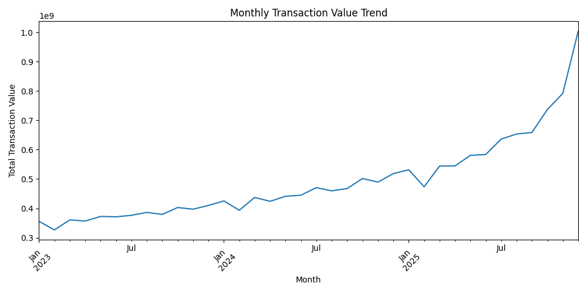
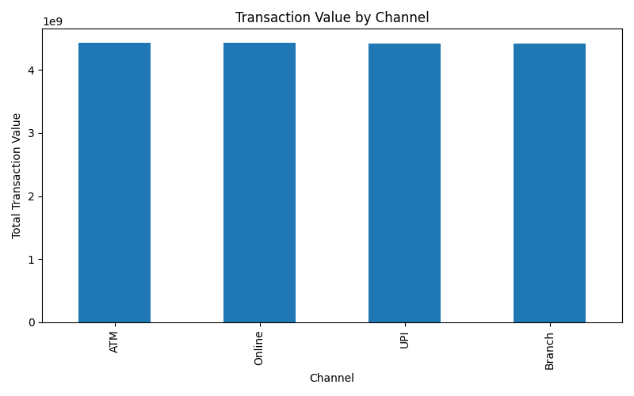

# Banking Customer & Transaction Analytics

An end-to-end banking data analytics project focused on customer behavior, account activity, transaction trends, and loan performance using Python, Pandas, NumPy, MySQL, SQL, Excel, and Matplotlib.

> **Project note:** The analytical work was completed using Python and SQL. A Power BI dashboard was considered as a presentation layer but was not implemented in the final version of the project.

---

## 1. Project Overview

This project analyzes a synthetic banking dataset containing four related entities:

- Customers
- Accounts
- Transactions
- Loans

The goal is to transform raw banking data into reliable analytical datasets, calculate meaningful banking KPIs, identify patterns and trends, and convert the findings into business-oriented suggestions.

The project covers:

- Data generation and preparation
- Data cleaning
- Data quality validation
- Exploratory Data Analysis (EDA)
- Descriptive statistics
- SQL-based business analysis
- Banking KPI calculation
- Data visualization
- Business insights and recommendations

---

## 2. Business Objectives

The analysis aims to answer questions such as:

- How many customers, accounts, transactions, and loans are present?
- Which customers have the highest total account balances?
- Which customers show the highest transaction activity?
- What is the total value of deposits and withdrawals?
- How are transactions distributed across banking channels?
- How has transaction value changed over time?
- What is the size of the loan portfolio?
- Which loan types are most common?
- How many loans are defaulted?
- What business actions can be suggested from the observed patterns?

---

## 3. Dataset

The project contains four related datasets.

### Customers

| Column | Description |
|---|---|
| `customer_id` | Unique customer identifier |
| `name` | Customer name |
| `age` | Customer age |
| `gender` | Customer gender |
| `city` | Customer city |
| `occupation` | Customer occupation |
| `account_open_date` | Account opening date |

**Records:** 10,000

### Accounts

| Column | Description |
|---|---|
| `account_id` | Unique account identifier |
| `customer_id` | Associated customer |
| `account_type` | Type of bank account |
| `balance` | Account balance |
| `account_status` | Account status |
| `account_open_date` | Account opening date |

**Records:** 20,012

### Transactions

| Column | Description |
|---|---|
| `transaction_id` | Unique transaction identifier |
| `account_id` | Associated account |
| `transaction_date` | Transaction date |
| `transaction_type` | Deposit or Withdrawal |
| `amount` | Transaction amount |
| `channel` | ATM, Online, Branch, or UPI |
| `category` | Transaction category |

**Records:** 383,242

### Loans

| Column | Description |
|---|---|
| `loan_id` | Unique loan identifier |
| `customer_id` | Associated customer |
| `account_id` | Associated account |
| `loan_type` | Type of loan |
| `loan_amount` | Loan amount |
| `interest_rate` | Interest rate |
| `loan_term_months` | Loan duration |
| `loan_start_date` | Loan start date |
| `loan_end_date` | Loan end date |
| `loan_status` | Active, Closed, or Defaulted |
| `monthly_payment` | Monthly payment |

**Records:** 4,789

---

## 4. Data Relationships

The datasets have natural relational links:

```text
                    CUSTOMERS
                   /         \
                  /           \
                 v             v
            ACCOUNTS         LOANS
                |
                v
          TRANSACTIONS
```

Key relationships:

```text
customers.customer_id  -> accounts.customer_id
customers.customer_id  -> loans.customer_id
accounts.account_id    -> transactions.account_id
accounts.account_id    -> loans.account_id
```

This structure allows customer-level analysis by joining information across multiple tables.

---

## 5. Data Cleaning & Quality Validation

Python and Pandas were used to inspect, clean, and validate the datasets.

Validation checks included:

- Duplicate records
- Missing values
- Invalid customer IDs
- Invalid account IDs
- Invalid loan references
- Invalid transaction types
- Invalid transaction channels
- Negative transaction amounts
- Invalid dates
- Invalid account statuses
- Invalid loan statuses
- Loan date consistency
- Referential integrity between related datasets

During validation, the account-status rule initially did not include the legitimate `Dormant` category. The rule was corrected and the validation was rerun.

**Final result: all data-quality checks passed successfully.**

---

## 6. Exploratory Data Analysis

Python was used for exploratory and statistical analysis with:

- Pandas
- NumPy
- Matplotlib

The EDA covered:

- Dataset structure and data types
- Descriptive statistics
- Transaction amount distribution
- Deposit vs. withdrawal analysis
- Monthly transaction trends
- Transaction channel analysis
- Loan analysis
- Potential outlier detection using the IQR method
- Banking KPI calculation

---

## 7. SQL Analysis

MySQL was used to analyze the relational banking data.

SQL concepts used include:

- `SELECT`
- `WHERE`
- `GROUP BY`
- `HAVING`
- `ORDER BY`
- `INNER JOIN`
- `LEFT JOIN`
- `COUNT`
- `SUM`
- `AVG`
- `MIN`
- `MAX`
- `CASE`
- Subqueries

Examples of analysis performed:

- Customers with the highest total account balances
- Customers with the highest transaction activity
- Deposit vs. withdrawal value
- Transaction analysis by channel
- High-value transaction classification
- Customers with the highest total loan amounts

---

## 8. Key Banking KPIs

| KPI | Value |
|---|---:|
| Total Customers | 10,000 |
| Total Accounts | 20,012 |
| Total Transactions | 383,242 |
| Total Loans | 4,789 |
| Total Account Balance | ₹788.94 Cr |
| Average Account Balance | ₹3.94 L |
| Total Transaction Value | ₹1,770.68 Cr |
| Average Transaction Value | ₹46,202.54 |
| Deposit Value | ₹970.74 Cr |
| Withdrawal Value | ₹799.93 Cr |
| Total Loan Value | ₹1,204.82 Cr |
| Average Loan Amount | ₹25.16 L |
| Defaulted Loans | 257 |
| Loan Default Rate | 5.37% |

> **Note:** The dataset is synthetic. These metrics describe the project's dataset and should not be interpreted as actual banking-industry figures.

---

## 9. Visualizations

The project currently includes Python-generated visualizations.

### Monthly Transaction Value Trend



### Transaction Channel Analysis



These visualizations were created using Matplotlib as part of the exploratory analysis.

---

## 10. Business Insights

The analysis produced the following observations from the dataset:

### 1. Transaction activity increased over time

Monthly transaction value shows an overall upward trend across the 2023–2025 period, with particularly strong activity toward the later part of 2025.

### 2. Deposits exceed withdrawals

The dataset contains approximately:

- **₹970.74 Cr** in deposits
- **₹799.93 Cr** in withdrawals

The difference is approximately **₹170.81 Cr**.

### 3. Banking channels have relatively balanced activity

ATM, Online, UPI, and Branch transactions have broadly similar transaction volumes in this dataset.

### 4. Loan portfolio contains defaulted accounts

There are **257 defaulted loans out of 4,789 loans**, corresponding to a dataset-level default rate of **5.37%**.

### 5. Transaction amounts show substantial variation

The average transaction amount is approximately **₹46,202.54**, while the median is approximately **₹44,760.54**, with a standard deviation of approximately **₹29,545.41**.

---

## 11. Business Suggestions

Based on the observed patterns, the following business-oriented suggestions were developed:

### Customer engagement

Customers with high balances or high transaction activity can be considered for targeted engagement, personalized banking offers, and relationship-management initiatives.

### Transaction channels

Since transaction activity is distributed across multiple channels, the bank can continue maintaining a consistent customer experience across ATM, Online, UPI, and Branch channels while monitoring channel-specific trends.

### Loan risk monitoring

The presence of defaulted loans suggests that loan portfolios should be monitored using indicators such as repayment behavior, loan type, outstanding amount, and customer history.

### High-value transactions

High-value transactions can be monitored separately to identify unusual patterns and support transaction-risk review processes.

### Trend monitoring

The upward monthly transaction trend can be monitored over time to understand changes in customer activity and transaction demand.

> These are analytical suggestions based on patterns in the synthetic dataset, not conclusions about a real bank.

---

## 12. Project Workflow

```text
Raw Banking Data
       |
       v
Data Inspection
       |
       v
Python / Pandas
       |
       v
Data Cleaning
       |
       v
Data Quality Validation
       |
       v
MySQL Database
       |
       v
SQL Analysis
       |
       v
Python EDA & Statistics
       |
       v
KPI Calculation
       |
       v
Visualization
       |
       v
Business Insights
       |
       v
Business Suggestions
```

---

## 13. Project Structure

```text
banking-data-analytics/
|
├── data/
│   ├── cleaned/
│   │   └── customers_cleaned.csv
│   |
│   └── raw/
│       ├── accounts.csv
│       ├── customers.csv
│       ├── loans.csv
│       └── transactions.csv
|
├── python/
│   ├── clean_data.py
│   ├── generate_accounts.py
│   ├── generate_data.py
│   ├── generate_loans.py
│   ├── generate_transactions.py
│   ├── inspect_data.py
│   ├── validate_data.py
│   └── eda.py
|
├── monthly_transaction_trend.png
├── transaction_channel.png
└── README.md
```

---

## 14. Tools & Technologies

- **Python**
- **Pandas**
- **NumPy**
- **Matplotlib**
- **MySQL**
- **SQL**
- **Excel**
- **Git & GitHub**

---

## 15. How to Run

### Clone the repository

```bash
git clone https://github.com/gauravpandey16072005-svg/banking-data-analytics.git
cd banking-data-analytics
```

### Create a virtual environment

```bash
python3 -m venv venv
```

### Activate the environment

On macOS/Linux:

```bash
source venv/bin/activate
```

### Install Python dependencies

```bash
pip install pandas numpy matplotlib
```

### Run EDA and KPI analysis

```bash
python python/eda.py
```

The EDA script performs exploratory analysis, descriptive statistics, KPI calculations, and generates visualizations.

---

## 16. Future Scope

Possible extensions include:

- Power BI dashboard for interactive reporting
- Customer segmentation
- Deeper loan-risk analysis
- Additional banking KPIs
- Automated reporting
- Advanced statistical analysis
- Predictive analytics and machine learning

---

## 17. Author

**Anand Pandey**

B.Tech — Electronics & Communication Engineering  
Malaviya National Institute of Technology, Jaipur

GitHub: `https://github.com/gauravpandey16072005-svg`
